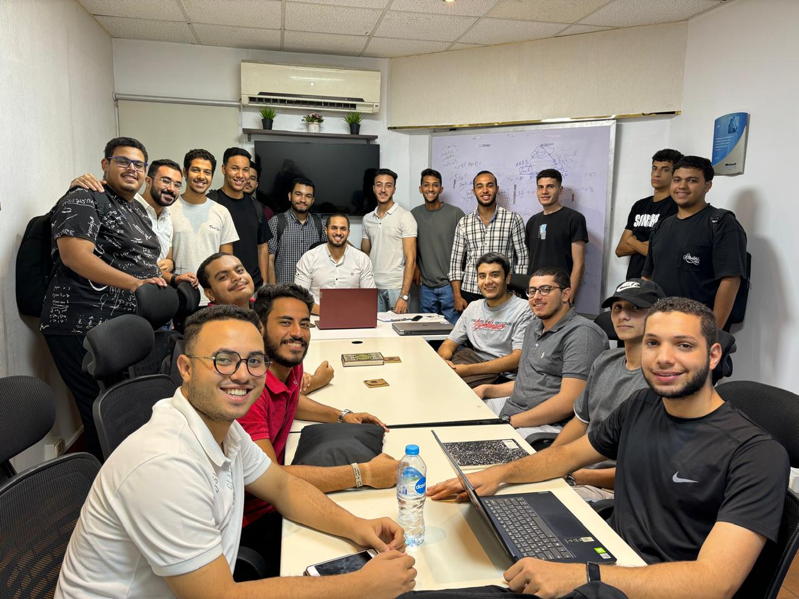

# BLACK SECTOR × OpenAI Codex

Building the Future of Practical Cybersecurity Education with AI

BLACK SECTOR is an independent cybersecurity education platform focused on practical learning through interactive security labs, realistic vulnerability scenarios, and hands-on technical exercises.

Our mission is to make advanced cybersecurity concepts more accessible while maintaining technical accuracy, practical depth, and a real-world learning experience.

Official Website: https://blacksector.cc

---

## About BLACK SECTOR

BLACK SECTOR is being developed as an educational platform for cybersecurity learners, penetration testers, developers, and security enthusiasts.

The platform focuses on:

- Interactive Security Labs — Hands-on educational experiences covering real cybersecurity concepts.
- Realistic Vulnerability Scenarios — Practical scenarios inspired by real-world security research and vulnerabilities.
- Progressive Learning Paths — Structured difficulty levels that help learners develop their technical skills.
- Technical Accuracy — Detailed HTTP requests, responses, and explanations of security concepts.
- Modern Learning Experience — A clean, responsive, and performance-focused educational environment.

Our goal is to help learners move beyond theoretical explanations and develop practical cybersecurity skills through realistic, structured learning experiences.

---

## Building with OpenAI Codex

OpenAI Codex plays an important role in our development workflow.

We use Codex as an AI-assisted engineering tool to help transform ideas into working software, investigate technical challenges, and continuously improve the BLACK SECTOR platform.

How We Use Codex

1. Feature Development

Supporting the development and refinement of platform features, educational interfaces, and interactive learning experiences.

2. Code Analysis and Troubleshooting

Investigating implementation issues, reviewing existing code, and exploring possible improvements.

3. Performance Optimization

Analyzing application behavior, identifying potential performance bottlenecks, and improving the responsiveness of the user experience.

4. Development Workflow

Breaking complex engineering tasks into manageable steps, evaluating implementation approaches, and supporting iterative development.

5. Testing and Quality Improvement

Helping develop testing strategies, examine edge cases, and evaluate changes before implementation or deployment.

We believe AI-assisted development is most valuable when combined with human technical judgment, independent verification, responsible engineering, and continuous testing.

---

## Codex in Practice

BLACK SECTOR provides a practical environment for exploring AI-assisted software engineering.

Our development workflows involve real technical challenges, including:

- Improving navigation responsiveness across educational pages.
- Refining interactive security lab interfaces.
- Investigating unexpected application behavior.
- Reviewing code changes for potential regressions.
- Maintaining consistency across different educational modules.
- Exploring approaches to software reliability and performance.

Codex assists throughout these workflows by helping analyze problems, propose implementation approaches, and support code refinement.

Changes are reviewed and tested rather than accepted solely because they were generated by AI.

This reflects our approach to responsible AI-assisted engineering: use AI to accelerate development while preserving technical accuracy and human oversight.

---

## Community Educational Session

As part of our educational and community-building efforts, we held an in-person session to discuss the BLACK SECTOR development roadmap and the role of OpenAI Codex in supporting our project.

The session brought participants together to explore how cybersecurity education, software engineering, and AI-assisted development can complement one another.

Our discussion centered on making advanced technical education more practical, accessible, and engaging.

Main Discussion Topics

1. Building BLACK SECTOR

We discussed the platform's educational objectives, its interactive learning environment, and opportunities for continued development.

2. Integrating Codex into Development Workflows

We explored how Codex can assist developers with:

- Software development and implementation.
- Code understanding and analysis.
- Debugging and troubleshooting.
- Technical problem-solving.
- Development workflow improvements.

3. Expanding Cybersecurity Labs

We discussed plans to expand our educational content through realistic security scenarios, practical technical exercises, and more advanced learning experiences.

4. Future Development Roadmap

We explored potential improvements to the platform, including additional educational labs, enhanced usability, and future AI-assisted capabilities.

5. AI and Cybersecurity Education

We discussed opportunities to use modern AI development tools to support technical learning while maintaining responsible security practices.

---

Community Session Photo

A moment from our educational session discussing BLACK SECTOR, its development roadmap, and the role of OpenAI Codex in AI-assisted engineering.

BLACK SECTOR community educational session — discussing cybersecurity education, software development, and AI-assisted engineering.

---

## Development Roadmap

Our long-term roadmap focuses on five major areas.

1. Expanding Educational Labs

Continue developing high-quality cybersecurity learning scenarios based on realistic vulnerabilities, published security research, and practical technical concepts.

2. Improving the Learning Experience

Maintain a fast, reliable, intuitive, and technically accurate educational platform.

3. Advancing AI-Assisted Development

Continue exploring effective ways to integrate OpenAI Codex into software development, troubleshooting, testing, and technical workflows.

4. Community Knowledge Sharing

Share development experiences, technical tutorials, educational resources, and lessons learned with developers and cybersecurity enthusiasts.

5. Exploring Future AI Capabilities

Research AI-powered capabilities that could support cybersecurity education, technical analysis, and authorized security testing.

These represent ongoing development priorities and future directions rather than claims that all planned capabilities have already been implemented.

---

## Our Community Vision

We believe advanced technical education should be accessible to more people, regardless of language or background.

BLACK SECTOR aims to help bridge the gap between theoretical cybersecurity knowledge and real-world technical skills.

We are especially interested in supporting Arabic-speaking cybersecurity learners and developers while making our educational work accessible to a wider international audience.

Through community discussions, practical projects, and AI-assisted development, we aim to encourage learners to understand technology deeply, experiment responsibly, and build meaningful technical skills.

---

## Why Codex Matters to Our Mission

Building a complex educational platform involves continuous learning, technical challenges, experimentation, and improvement.

Codex helps us explore solutions, reduce repetitive engineering effort, and focus more attention on the quality of the learning experience.

We want to share these practical experiences with other developers, demonstrating how AI-assisted engineering can support the development of real-world projects.

Our vision extends beyond building a platform.

We want to help more people learn, build, and understand technology through practical education and responsible AI-assisted development.

---

## Connect with BLACK SECTOR

Official Website: https://blacksector.cc

Project: BLACK SECTOR

Focus: Cybersecurity Education | Interactive Labs | AI-Assisted Software Development

---

## BLACK SECTOR — Learn. Build. Secure.

BLACK SECTOR is an independent educational project. It is not affiliated with, sponsored by, or endorsed by OpenAI.

OpenAI Codex is referenced as a development tool used in the project.
